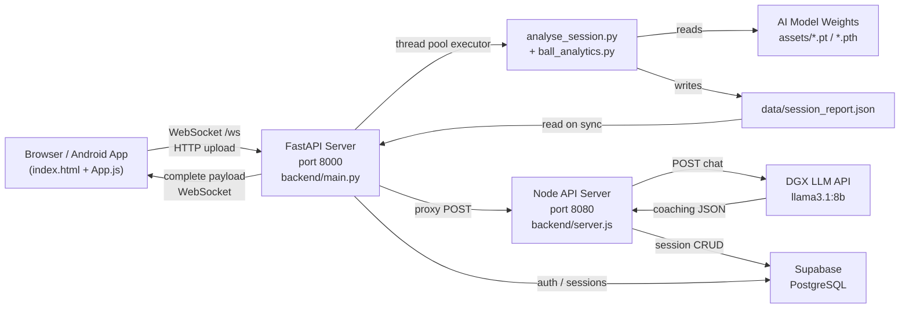

# 🏗️ CrickEye – Technical Architecture

This document is for developers and technical reviewers. It covers the system design, stack, file map, API protocols, and configuration.

---

## System Overview



---

## Technology Stack

| Layer | Technology | Purpose |
|---|---|---|
| **Frontend** | Vanilla JS (App.js), HTML5, CSS3 | Player dashboard, webcam capture, wagon wheel, charts |
| **UI Components** | ReportModal.js, PlayCard.js, wagonWheel.js, PitchMap.js, ballAnalytics.js, lengthInsights.js | Modular UI builders |
| **Backend (Python)** | FastAPI + Uvicorn (port 8000) | WebSocket pipeline, file serving, API proxy to Node |
| **Backend (Node)** | Express.js (port 8080) | Supabase session CRUD, LLM insights route |
| **AI — Pose** | YOLOv8n-pose (Ultralytics) | 17-keypoint body pose extraction per frame |
| **AI — Shot Classifier** | Custom PyTorch CNN (ResNet base) | 5-class shot type classification |
| **AI — Ball Tracker** | YOLO (Ultralytics) | Ball detection, trajectory, speed estimation |
| **AI — Coaching** | Meta llama3.1:8b via DGX API | Natural language coaching text generation |
| **Cloud Storage** | Supabase (PostgreSQL + RLS) | User accounts, session records, results JSONB |
| **Local Storage** | data/session_report.json | Most recent session payload (disk cache) |
| **Mobile** | Android WebView (Java) | Native phone wrapper for the web app |
| **Tunnel** | Cloudflare Tunnel (tunnel.js) | Optional public URL for live demo |

---

## Key Files Reference

| File | Role |
|---|---|
| `analyse_session.py` | Main AI pipeline: video → pose → shot → biomechanics → JSON output |
| `ball_analytics.py` | YOLO ball detection, delivery analytics, length zone classification |
| `backend/main.py` | FastAPI app: WebSocket endpoint (`/ws`), file serving, `/upload`, `/llm-insights` proxy, `/api/last-session` |
| `backend/server.js` | Node/Express: Supabase session CRUD, `/llm-insights` route, Cloudflare tunnel |
| `backend/services/llmInsights.js` | DGX API caller, prompt builder (`buildPrompt()`), response parser (`extractJsonObject()`) |
| `backend/routes/llmInsights.js` | POST `/llm-insights` Express route handler |
| `backend/services/supabaseAdmin.js` | Supabase admin client |
| `App.js` | Full frontend application: WebSocket client, state machine, all UI logic |
| `index.html` | HTML shell, auth gate overlay, app structure |
| `style.css` | Global and component styles |
| `components/ReportModal.js` | Net Session Report HTML builder + AI Coach card + PlayCard builders |
| `components/PlayCard.js` | Live dashboard session score panel (shown beside video after analysis) |
| `components/wagonWheel.js` | SVG wagon wheel renderer |
| `components/PitchMap.js` | Pitch map SVG with ball landing dots |
| `components/ballAnalytics.js` | Ball delivery summary cards |
| `components/lengthInsights.js` | Ball length zone tables and stats |
| `components/tone.js` | Shared colour/score theming utilities |
| `components/skeleton.js` | Loading skeleton state manager |
| `data/session_report.json` | Most recent session analysis output (read by `/api/last-session`) |
| `assets/yolov8n-pose.pt` | YOLOv8 pose detection model weights |
| `assets/crickeye_best.pth` | Custom shot classifier weights |
| `assets/best_ball.pt` | YOLO ball tracker weights |
| `backend/supabase_schema.sql` | Full database schema and RLS policies |

---

## WebSocket Message Protocol

The FastAPI server communicates with the browser client via WebSocket at `/ws`.

### Client → Server (actions)
```json
{ "action": "analyze", "video_path": "/uploads/session_id/video.mp4" }
{ "action": "sync" }
{ "action": "ping" }
```

### Server → Client (message types)

| `type` | When Sent | Payload Fields |
|---|---|---|
| `stage` | Pipeline progress | `stage` (string), `message` (string) |
| `progress` | Percentage complete | `progress` (0–100) |
| `onsets_found` | Shot boundaries detected | `count` (int) |
| `shot` | Each shot scored | Full per-shot object (label, scores, flags, timestamp) |
| `analysis` | Session analysis ready | Full `analysis` object (session_summary, coaching_alerts, etc.) |
| `complete` | Pipeline finished | Full payload: total_shots, shots[], analysis, llm_insights, output_video, ball_analytics |
| `warning` | Non-fatal issue | `message` (string) |
| `error` | Fatal error | `message` (string) |
| `pong` | Ping response | — |

---

## LLM Insights Flow

```
POST /llm-insights  (from browser or backend sync)
       │
       ▼  backend/main.py proxy
POST http://localhost:8080/llm-insights
       │
       ▼  backend/routes/llmInsights.js
generateLlmInsights(results)
       │
       ├── summarizeForPrompt(results)
       │     Extracts: avg_head, avg_stance, avg_footwork, avg_swing_path,
       │     avg_shot_score, coaching_alerts, by_shot_type, trend
       │
       ├── buildPrompt(summary)
       │     System prompt: "You are a cricket batting coach. Return STRICT JSON..."
       │     + compact session data JSON
       │
       └── callDgx(prompt)
             POST to DGX_LLM_URL with model=DGX_LLM_MODEL
             Response parsed → extractJsonObject() → normalizeInsightPayload()
             → { summary, strengths, improvements, shot_type_notes,
                 metric_notes, recommended_drills, provider, model,
                 fallback_used: false }
```

If DGX call fails → `buildFallbackInsights()` returns rule-based content with `fallback_used: true`.

---

## Supabase Database Schema

**Table: `sessions`**

| Column | Type | Description |
|---|---|---|
| `id` | UUID | Primary key |
| `user_id` | UUID | References auth.users |
| `status` | text | `pending` / `processing` / `completed` / `error` |
| `results` | JSONB | Full analysis payload (see below) |
| `video_url` | text | Storage URL of original video |
| `file_hash` | text | SHA-256 of uploaded video (for cache) |
| `analysis_cache_version` | int | Pipeline version for cache invalidation |
| `created_at` | timestamptz | Session creation time |

**`results` JSONB structure:**
```json
{
  "analysis": { "session_summary": {}, "coaching_alerts": [], ... },
  "replay": { "complete": {}, "shots": [] },
  "ball_analytics": {},
  "llm_insights": { "provider": "dgx", "model": "llama3.1:8b", ... },
  "file_fingerprint": "sha256...",
  "analysis_cache_version": 5
}
```

---

## Environment Variables

All set in `backend/.env`:

| Variable | Default | Description |
|---|---|---|
| `SUPABASE_URL` | — | Supabase project URL |
| `SUPABASE_ANON_KEY` | — | Supabase public anon key |
| `SUPABASE_SERVICE_ROLE_KEY` | — | Supabase service role key (server-only) |
| `DGX_API_KEY` | — | DGX LLM service API key |
| `DGX_LLM_URL` | `https://ai-services.mietjmu.in/gateway/llm/chat` | DGX endpoint |
| `DGX_LLM_MODEL` | `llama3.1:8b` | LLM model name |
| `LLM_INSIGHTS_ENABLED` | `false` | Enable live LLM coaching |
| `LLM_PROVIDER` | `dgx` | LLM provider (`dgx` or `gemini`) |
| `LLM_TIMEOUT_MS` | `60000` | LLM request timeout in milliseconds |
| `LLM_MAX_OUTPUT_TOKENS` | `4096` | Max tokens in LLM response |
| `PORT` | `8080` | Node server port |
| `BALL_ANALYTICS_ENABLED` | `1` | Set to `0` to disable ball tracker |

---

## Shot Classification Model

- **Base**: ResNet (custom head)
- **Classes**: `['cover', 'flick', 'pull', 'straight', 'sweep']`
- **Confidence threshold**: 0.28 (shots below this are marked "unclear" and excluded)
- **Input**: Pose keypoint sequence extracted by YOLOv8n-pose across the shot window
- **Output**: Shot label + confidence + per-class probability array

---

## Android App

The Android app (`android/`) is a WebView wrapper that:
- Loads the web app from the configured server URL
- Adds native features: screen wake-lock, haptic vibration on countdown beeps, back-button handling, camera picker
- Built with Java + Gradle (`build_apk.bat` automates asset sync + APK build)
- Communicates with the same WebSocket endpoint as the web browser
